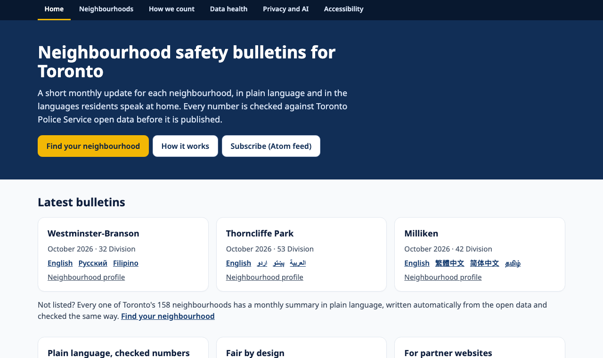
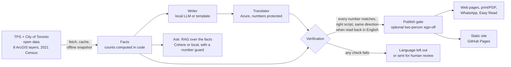
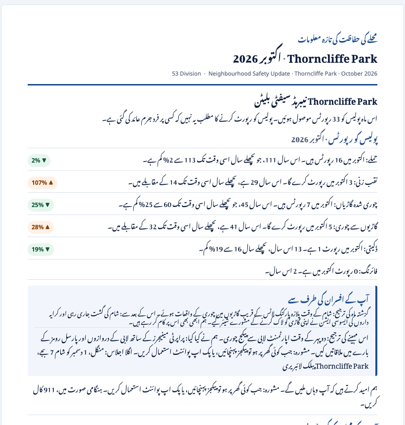

# NeighbourBrief TO

**Turns Toronto Police Service open data into plain-language, multilingual neighbourhood safety bulletins, with every number checked by code before anything is published.**

**Live demo:** https://kartik-joshi.github.io/neighbourbrief-to/ (the static public site, rebuilt from this repo)

> Independent prototype. Not affiliated with or endorsed by the Toronto Police Service or the City of Toronto.



## The problem

Toronto Police Service (TPS) publishes detailed crime and collision data for all 158 of the city's
neighbourhoods. But it is published as ArcGIS layers and dashboards, in English, and the people who need it are at
community meetings and in WhatsApp groups. In many neighbourhoods a large share of residents speak another language at home: Urdu is 20.8% of
Thorncliffe Park (2021 Census), and Tamil, Punjabi and Gujarati lead in others.

Writing a monthly update by hand, in several languages, is slow. Doing it with a language model is fast but
risky: a translated "down 3%" that becomes "up 3%", or an invented count, damages trust in exactly the
communities where trust matters most. NeighbourBrief is built around one rule: **code counts, AI only
phrases, and nothing is published unless every number in every language matches the data.**

## How it works



1. **Facts (no AI).** `app/data/` pulls TPS layers (crime, collisions, officers, community services,
   boundaries) and City data (wards, home languages), and computes last month, year to date and the
   same period last year. Small-number rules: no percentages below 10, shootings and homicides as counts only.
2. **Writing.** A local model (Ollama, `gemma3:12b`) drafts a Grade 6 text around the officer's own
   priority. If the model is down or invents a number, a template writer produces the same structure.
   Automatic bulletins for all 158 neighbourhoods use the template only.
3. **Translation** into the neighbourhood's top home languages (23 supported) with Azure Translator,
   numbers protected.
4. **Verification** (`app/verify/`). Every number in English and in each translation must match the facts. Each
   translation must be in the right script (no Devanagari in Urdu), and it is read back in English
   so a direction can't flip. Tone, personal information and statements about groups are checked too.
   A language that fails is left out or goes to a human translator queue.
5. **Ask** (`app/rag/`): questions in any language, answered from the same facts with Cohere
   (Embed, Rerank, Command A with citations) or a local model. Ranking questions ("which area is
   most dangerous?") are declined, and any answer containing a number not found in the retrieved documents is held back.
   Details: [docs/COHERE.md](docs/COHERE.md).

The staff app (FastAPI) runs on the officer's own computer and listens on localhost only. The public site is
plain static files built by `scripts/build_public_site.py`.

## Results

These are measured, not projected. Sources are linked.

- **Numbers match the source.** 450 counts on 18 neighbourhood profiles (including the 3 demo
  neighbourhoods) all matched the TPS portal's own queries (November 2026).
- **Ask evaluation** ([docs/COHERE.md](docs/COHERE.md), Nov 22, 2026; 24 questions generated from live facts for
  3 neighbourhoods, plus one question asked in 22 languages):
  - Cohere (Embed, Rerank, Command A): 92% correct (22/24), the right source cited every time, a median of 3.4 s. Across the languages
    it got 19/22, including all 14 that Command A documents. The 3 misses (Pashto, Gujarati, Somali) are all languages it doesn't document.
  - Local model (gemma3:12b): 96% correct (23/24) and 18/22 across the languages. In the 4 language misses it wrote "Sixteen" in words.
  - Sources-only fallback (no generation): 96 to 100% correct over two runs and 22/22 across the languages.
  - Ranking questions were declined every time, by every engine.
- **Translations.** In the end-to-end run with the real model and Azure, 8/8 languages were verified and meaning-checked
  and 3/3 bulletins published ([docs/TEST_REPORT.md](docs/TEST_REPORT.md), round 6).
- **Public site.** 1,993 pages in all (158 profiles, automatic bulletins, ward briefs, feeds). A live crawl found
  every one of its 2,643 files and 2,165 internal links working, and the required licence attribution on every page.
- **Quality gates.** 276 automated tests, which run offline. axe-core reports 0 WCAG 2.1 AA
  violations, and a keyboard-only test passes. A visual check fails the build if a bulletin doesn't fit one printed page.

| Urdu bulletin (right to left, numbers verified) | |
|---|---|
|  | Each bulletin is also available as large print, Easy Read, a CSV of the numbers, a calendar invite for the next community meeting, a QR code and an embeddable card. |

## Run it

Requires Python 3.12. Ollama is optional: without it, drafts use the template writer and Ask quotes its sources.

```bash
python3 -m venv .venv
.venv/bin/pip install -r requirements.txt
cp .env.example .env            # add keys here only (Azure Translator, Cohere): never in code
.venv/bin/uvicorn app.main:app --port 8000
```

Open http://127.0.0.1:8000. To run with no internet, set `DEMO_OFFLINE=true` in `.env`. The app then uses the snapshot in `data/demo_snapshot/`.

```bash
.venv/bin/python -m pytest -q                         # 276 tests, offline
.venv/bin/python scripts/build_public_site.py --hoods all   # build the static site into public_site/
```

Docker, offline demos, Azure and Cohere setup, and troubleshooting are covered in **[docs/GUIDE.md](docs/GUIDE.md)**.

## Tech stack

- **Backend:** Python 3.12, FastAPI, Jinja2, httpx
- **Data:** TPS Public Safety Data Portal (ArcGIS REST), City of Toronto Open Data, cached on disk, with an offline snapshot
- **AI:** Ollama (`gemma3:12b`, `bge-m3`) locally. Cohere Embed, Rerank and Command A for Ask. Azure Translator. A provider-agnostic
  client that also supports Azure OpenAI and Anthropic.
- **Frontend:** server-rendered HTML, pre-built Tailwind CSS, Leaflet maps. No JavaScript framework.
- **Testing:** pytest, Playwright (visual and print fit), axe-core (accessibility), plus a parity check between the
  JavaScript and Python number checkers
- **Deploy:** static site on GitHub Pages; Docker image and a Cloudflare tunnel script for live demos

## Engineering decisions

- **The model never computes or supplies a number.** Counts come from code, and the model writes the sentences around them.
  Every number is then extracted from the output and compared with the facts, in every language and script.
- **Fail closed, per language.** A translation that fails a check is dropped or sent for human review. It is never
  published with a warning.
- **Fairness rules are in code, not in a prompt.** The app never ranks neighbourhoods or maps incident locations, and it gives no percentages on small counts.
  Ranking questions to Ask are declined by a rule before any model runs.
- **Local first.** The staff app listens on localhost and runs fully offline with a local model, for venues with no Wi-Fi.
  The public output is static files that any host can serve.
- Further choices and their reasons are logged in [docs/DECISIONS.md](docs/DECISIONS.md).

## Limitations and next steps

- **Prototype.** It has not been adopted or reviewed by TPS. The demo bulletins' officer text is sample text.
- **Machine translation** is checked for numbers, script and meaning, but no community translator has reviewed
  it yet. The review queue exists; it needs people.
- **The live site is static**, so Ask, Check my numbers, staff tools and feedback need the running app.
- **Ask's number guard** catches invented numbers, not a real number attached to the wrong period. The evaluation found one
  such answer: last year's year-to-date total was presented as last year's month. A binding check like the bulletins' would close the gap.
- **Not yet tested live:** the Azure OpenAI and Anthropic writer paths. A Cohere evaluation run uses about 215 of a trial key's
  1,000 monthly calls, so the app caps its own use at 300 a month (`COHERE_MONTHLY_CALLS`).
- **TPS data lags.** Current-year data reloads daily and quarterly data trails by a few months, so bulletins
  say which period each number covers.
- **Next:** CI on every push; Aya or answer translation for the languages Command A doesn't document; a pilot with one
  Community Police Liaison Committee; a hosted deployment for Ask with the rate limits already in `app/ratelimit.py`.

## Repository layout

```
app/data/     TPS + City data fetch, facts, profiles      app/verify/  number, script, meaning and content checks
app/ai/       writer, translator, LLM + Cohere clients    app/rag/     Ask: corpus, retrieval, guarded answers
app/templates/ pages and the bulletin                     scripts/     site build, checks, evals, demo tools
tests/        pytest suite                                docs/        guide, decisions, test report, RAG evaluation
```

The built site is published to a separate repo, [kartik-joshi/neighbourbrief-to](https://github.com/kartik-joshi/neighbourbrief-to),
which serves GitHub Pages. That repo is generated output; edit this one.

## Licence

Code: [MIT](LICENSE). Bundled third-party code keeps its own licence: see
[app/static/vendor/THIRD_PARTY_NOTICES.txt](app/static/vendor/THIRD_PARTY_NOTICES.txt).

Data (downloaded by the app; `data/demo_snapshot/` keeps a small copy for offline demos):

- Toronto Police Service Public Safety Data Portal: Major Crime Indicators, Neighbourhood Crime Rates,
  year-to-date crime, Traffic Collisions, Theft from Motor Vehicle, Bicycle Thefts, Neighbourhood Community
  Officers, Community Assets, Neighbourhoods (158) boundaries. Contains information licensed under the [Open Government Licence – Ontario](https://www.ontario.ca/page/open-government-licence-ontario).
- City of Toronto Open Data: City Wards and Neighbourhood Profiles (2021 Census languages). Contains information licensed under the [Open Government Licence – Toronto](https://www.toronto.ca/city-government/data-research-maps/open-data/open-data-licence/).
- Map tiles © [OpenStreetMap](https://www.openstreetmap.org/copyright) contributors (shown on the map, not stored here).

The data is provided by its publishers "as is", without warranty. This project uses no Toronto Police Service or
City of Toronto branding, crests or logos, and is not affiliated with or endorsed by either. Translations in
`data/translation_memory/` were made by machine (Azure Translator) from this project's own English text and passed its checks.
